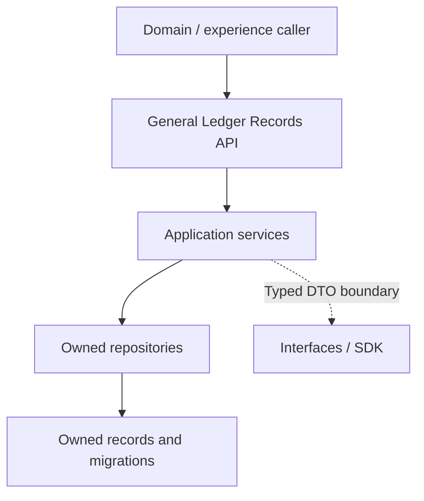

<a href="https://fireflysoftware.io/openplatform/">
<picture>
  <source media="(max-width: 640px) and (prefers-color-scheme: dark)" srcset="https://raw.githubusercontent.com/firefly-oss/.github/main/profile/assets/banner-narrow-dark.svg">
  <source media="(max-width: 640px)" srcset="https://raw.githubusercontent.com/firefly-oss/.github/main/profile/assets/banner-narrow-light.svg">
  <source media="(prefers-color-scheme: dark)" srcset="https://raw.githubusercontent.com/firefly-oss/.github/main/profile/assets/banner-dark.svg">
  
</picture>
</a>

# General Ledger Records

Core data service for GL accounts, journal batches, entries, and lines in Firefly OpenPlatform.

[Platform documentation](https://docs.fireflysoftware.io/) · [Source reference](docs/openplatform/reference.md) · [Source inventory](docs/openplatform/source-inventory.json)

## Purpose, scope, and readiness

This service owns GL accounts, journal batches, entries, and lines. Its controllers expose typed record operations; services and repositories apply the local persistence and lifecycle behavior. Domain and experience services compose those operations into customer or staff journeys.

The current source contains the declarations indexed in the companion reference. Functional readiness is bounded by the implemented handlers, adapters, and tests; this guide does not elevate a record API, sample provider, or unexecuted test into a completed business journey.

## Business ownership and supported journeys

Maintain the chart of accounts and journal structures used to classify financial activity for accounting.

A journal CRUD API is not a general accounting close, a reconciliation engine, or proof that postings are balanced across all callers.

| Entry point | Declared operations |
| --- | --- |
| [GlAccountController](core-common-accounting-gl-web/src/main/java/io/fireflysoftware/core/accounting/web/controllers/account/GlAccountController.java) | `GET /api/v1/gl-accounts/{id}`; `GET /api/v1/gl-accounts`; `GET /api/v1/gl-accounts/{parentId}/children`; 4 more declarations |
| [JournalBatchController](core-common-accounting-gl-web/src/main/java/io/fireflysoftware/core/accounting/web/controllers/journal/JournalBatchController.java) | `GET /api/v1/journal-batches/{id}`; `GET /api/v1/journal-batches`; `POST /api/v1/journal-batches`; 2 more declarations |
| [JournalEntryController](core-common-accounting-gl-web/src/main/java/io/fireflysoftware/core/accounting/web/controllers/journal/JournalEntryController.java) | `GET /api/v1/journal-batches/{batchId}/entries/{entryId}`; `GET /api/v1/journal-batches/{batchId}/entries`; `POST /api/v1/journal-batches/{batchId}/entries`; 2 more declarations |
| [JournalLineController](core-common-accounting-gl-web/src/main/java/io/fireflysoftware/core/accounting/web/controllers/journal/JournalLineController.java) | `GET /api/v1/journal-batches/{batchId}/entries/{entryId}/lines/{lineId}`; `GET /api/v1/journal-batches/{batchId}/entries/{entryId}/lines`; `POST /api/v1/journal-batches/{batchId}/entries/{entryId}/lines`; 2 more declarations |

The complete [operation reference](docs/openplatform/reference.md#http-operations) lists each mapping and its owning method. These are source declarations; conditional beans, inherited controllers, security filters, and deployment routing can change the effective runtime API.

## Consumer example: create and reread a synthetic gl account

Use a disposable migrated instance with the matching service/SDK release, the configuration below, and a caller authorized for the tenant and operation. Replace `service.example.invalid` with that instance; this reserved host is deliberately not a deployed endpoint. This core request stores the aggregate locally; it does not call an external provider simply because a record was created.

**Inputs and fixture ownership.** The `GlAccountDTO` schema requires no bean-required properties in this OpenAPI schema; database/service constraints still apply. The JSON below contains those fields, uses declared enum values, and omits the generated record ID. Synthetic UUIDs are not seed data: replace them with the owned IDs obtained above. Dates and business reference strings are examples; choose a new reference for each disposable fixture.

```http
POST /api/v1/gl-accounts HTTP/1.1
Host: service.example.invalid
Content-Type: application/json

{
  "code": "SYNTHETIC-CASH-001",
  "name": "Synthetic cash asset",
  "type": "ASSET",
  "leaf": true,
  "active": true,
  "currency": "USD"
}
```

**Expected behavior.** On a successful service result, the controller returns HTTP 200 OK with the created `GlAccountDTO` representation. Validation, nonexistent parents, duplicate business references, or a missing downstream/database can prevent success. A stored record does not establish the business side effects of underwriting, settlement, external authentication, or regulatory acceptance. This creates an ASSET account in the chart, not a posted journal or a customer cash balance. This controller parameter has no explicit @Valid annotation; OpenAPI-required fields describe the request contract and do not by themselves prove HTTP bean-validation enforcement.

**Verification and recovery.** Read the returned record ID with `GET /api/v1/gl-accounts/{id}`, substituting the response ID, and compare the business fields and parent references. If creation times out, inspect the owner for the business reference before retrying. Do not infer write deduplication from an idempotency header or a cached response. An absent prerequisite is a blocked integration run, not a reason to substitute an arbitrary UUID.

**Execution evidence.** Source checked against the local HTTP declaration and checked-in OpenAPI request schema. This documentation worker has not submitted this payload to a running service; full owner fixtures, deployment authentication, and live-provider acceptance are unverified.

Source of this example: [GlAccountController](core-common-accounting-gl-web/src/main/java/io/fireflysoftware/core/accounting/web/controllers/account/GlAccountController.java), [openapi](core-common-accounting-gl-sdk/src/main/resources/openapi.yml), [GlAccountDTO](core-common-accounting-gl-interfaces/src/main/java/io/fireflysoftware/core/accounting/intefaces/dtos/account/GlAccountDTO.java), [GlAccountService](core-common-accounting-gl-core/src/main/java/io/fireflysoftware/core/accounting/core/services/account/GlAccountService.java), [GlAccountServiceImpl](core-common-accounting-gl-core/src/main/java/io/fireflysoftware/core/accounting/core/services/account/impl/GlAccountServiceImpl.java).

## Architecture and repository layout



| Module | Responsibility |
| --- | --- |
| [core-common-accounting-gl-web](core-common-accounting-gl-web/) | HTTP entry points, boot application, and runtime configuration. |
| [core-common-accounting-gl-interfaces](core-common-accounting-gl-interfaces/) | Public DTOs, commands, queries, and contracts shared across the module boundary. |
| [core-common-accounting-gl-models](core-common-accounting-gl-models/) | Persisted entities, repositories, and database migrations; this is the data ownership boundary. |
| [core-common-accounting-gl-core](core-common-accounting-gl-core/) | Application services, handlers, and business coordination; inspect these implementations for lifecycle rules. |
| [core-common-accounting-gl-sdk](core-common-accounting-gl-sdk/) | Client artifact and OpenAPI generation configuration; build it from the matching service contract. |

## Contracts, data, authentication, and errors

Use the request and response types declared by each operation. Preserve stable record identifiers, monetary amounts/currencies, and lifecycle values when crossing a boundary. Source links below make the owned data shape inspectable without copying an unrelated service model.

| Data type | Declared fields (selection) |
| --- | --- |
| [GlAccount](core-common-accounting-gl-models/src/main/java/io/fireflysoftware/core/accounting/models/entities/account/GlAccount.java) | `id`, `code`, `name`, `type`, `parentId`, `isLeaf`, `active` |
| [JournalBatch](core-common-accounting-gl-models/src/main/java/io/fireflysoftware/core/accounting/models/entities/journal/JournalBatch.java) | `id`, `reference`, `status`, `batchDate`, `remarks`, `createdAt`, `updatedAt` |
| [JournalEntry](core-common-accounting-gl-models/src/main/java/io/fireflysoftware/core/accounting/models/entities/journal/JournalEntry.java) | `id`, `batchId`, `transactionId`, `sourceModule`, `totalAmount`, `description`, `entryDate` |
| [JournalLine](core-common-accounting-gl-models/src/main/java/io/fireflysoftware/core/accounting/models/entities/journal/JournalLine.java) | `id`, `entryId`, `accountId`, `amount`, `drCr`, `memo`, `fxCurrency` |

The [data contract reference](docs/openplatform/reference.md#data-contracts) indexes **8 DTO, record, or entity declarations** and their fields. Read DTO validation annotations together with service logic and migrations; a field's presence does not establish that every endpoint accepts it.

Use the authentication and authorization behavior actually enforced by the deployed entry point. Tenant, party, distributor, and staff identifiers carry business scope; they must not be accepted as proof of identity. Preserve validation and downstream errors rather than mapping an unavailable dependency to a successful business result.

Examples of locally enforced failure or access behavior:

| Declared check or failure | Implementation |
| --- | --- |
| `new IllegalArgumentException("No account found with ID: " + id)));` | [GlAccountServiceImpl](core-common-accounting-gl-core/src/main/java/io/fireflysoftware/core/accounting/core/services/account/impl/GlAccountServiceImpl.java) |
| `new IllegalArgumentException("No account found with ID: " + id)))` | [GlAccountServiceImpl](core-common-accounting-gl-core/src/main/java/io/fireflysoftware/core/accounting/core/services/account/impl/GlAccountServiceImpl.java) |
| `new IllegalArgumentException("No journal batch found with ID: " + id)));` | [JournalBatchServiceImpl](core-common-accounting-gl-core/src/main/java/io/fireflysoftware/core/accounting/core/services/journal/impl/JournalBatchServiceImpl.java) |
| `new IllegalArgumentException("No journal batch found with ID: " + id)))` | [JournalBatchServiceImpl](core-common-accounting-gl-core/src/main/java/io/fireflysoftware/core/accounting/core/services/journal/impl/JournalBatchServiceImpl.java) |
| `new IllegalArgumentException("No journal entry found with ID: " + entryId)));` | [JournalEntryServiceImpl](core-common-accounting-gl-core/src/main/java/io/fireflysoftware/core/accounting/core/services/journal/impl/JournalEntryServiceImpl.java) |
| `new IllegalArgumentException("No journal entry found with ID: " + entryId)))` | [JournalEntryServiceImpl](core-common-accounting-gl-core/src/main/java/io/fireflysoftware/core/accounting/core/services/journal/impl/JournalEntryServiceImpl.java) |

The [security and failure reference](docs/openplatform/reference.md#security-and-failure-evidence) links local authorization annotations, status mappings, and exception sites. Framework or gateway policy is additional to this local inventory; verify the deployed filter chain and caller entitlements before integration.

## External dependencies, sandbox behavior, and replacement

The local port and bean-selection inventory below distinguishes the declared abstraction from its configured implementation. An SDK client is an outbound integration; its presence does not establish a working provider connection. Where a sandbox adapter is selected, its behavior is synthetic and limited to what that adapter implements.

For a project-specific provider, implement the existing typed boundary and select it through the repository wiring. Preserve the caller-visible validation, lifecycle, error, correlation, and retry semantics; verify both successful and failed requests against the same contract. Supply endpoint/credentials through configuration. If no sandbox selector is listed, do not invent one or silently introduce sample success as a fallback.

## Configuration and local setup

Runtime configuration sources: [openapi.yml](core-common-accounting-gl-sdk/src/main/resources/openapi.yml), [GeneralLedgerApplication.java](core-common-accounting-gl-web/src/main/java/io/fireflysoftware/core/accounting/web/GeneralLedgerApplication.java), [application.yaml](core-common-accounting-gl-web/src/main/resources/application.yaml).

The original OpenAPI producer writes the SDK input at `core-common-accounting-gl-sdk/src/main/resources/openapi.yml`. The SDK build derives the packaged `/api-spec/openapi.yml` compatibility resource from that same input during `process-resources`; it is not maintained as a second source specification. Regenerate SDK classes through the configured OpenAPI lifecycle.


| Environment variable or property | Declared fallback |
| --- | --- |
| `spring.application.name` | Required by this expression |
| `spring.application.version` | Required by this expression |
| `spring.application.description` | Required by this expression |
| `spring.application.team.name` | Required by this expression |
| `spring.application.team.email` | Required by this expression |
| `DB_HOST` | Required by this expression |
| `DB_PORT` | Required by this expression |
| `DB_NAME` | Required by this expression |
| `DB_SSL_MODE` | Required by this expression |
| `DB_USERNAME` | Required by this expression |
| `DB_PASSWORD` | Required by this expression |
| `SERVER_ADDRESS` | `localhost` |
| `SERVER_PORT` | `8080` |

See the [complete configuration reference](docs/openplatform/reference.md#configuration) for every placeholder and its source, including differences between profiles. A fallback is a code default, not a deployment recommendation. Secret defaults are redacted.

Build coordinates: `io.fireflysoftware:core-common-accounting-gl:26.10.6`. Parent: `io.fireflysoftware:firefly-parent:26.10.6`. The POM is the compatibility source of truth.

Use the CI-declared JDK `25` and Maven available on your path. This root POM declares `java.version` / compiler release `25`; a lower source target does not lower the JDK needed to consume framework dependencies. Resolve the parent/BOM and internal SDK artifacts before launching a child module. The framework baseline comes through `firefly-parent`; provider adapters should use the corresponding Jafly modules instead of duplicating framework infrastructure.

```sh
mvn --version
mvn -B verify
```

`verify` compiles the reactor and executes the checks bound by the effective POM. A successful dependency resolution or skipped-test package is not a test result. SDK generation may require a running API specification endpoint; inspect the SDK POM before selecting its generation profile.

The current OpenPlatform parent enables `generate-openapi` when `skipOpenApiGen` is absent. Applicable web modules start an OpenAPI generation application on port **18080**, fetch `/v3/api-docs.yaml`, and stop it during the integration-test lifecycle. To validate code against the checked-in API specification without that application-startup step, use:

```sh
mvn -B verify -DskipOpenApiGen
```

This switch does not skip tests or the SDK module's own source generation. It does omit fresh application-generated OpenAPI evidence; run the complete configured lifecycle when qualifying an API change.

After dependencies and configuration are ready, build/install reactor artifacts and launch the web module:

```sh
mvn -B install
mvn -pl core-common-accounting-gl-web spring-boot:run
```

Run against disposable local infrastructure first. Supply endpoint/database variables from the configuration reference; a default localhost URL does not start that dependency.

Locally declared build plugins: `maven-compiler-plugin`, `maven-resources-plugin`, `openapi-generator-maven-plugin`, `spring-boot-maven-plugin`. Inherited checks remain governed by the parent POM.

The checkout contains **1 test source/resource files**. See the [test source index](docs/openplatform/reference.md#test-sources) for coverage locations. This inventory is not evidence that those tests passed.

CI definitions: [maven-central.yml](.github/workflows/maven-central.yml), [release.yml](.github/workflows/release.yml).

## Operations and recovery

On failure, retain the request and business record identifiers, inspect the owning controller/service and downstream status, then verify the current persisted state before retrying. Distinguish invalid input, denied access, missing records, and unavailable infrastructure. Avoid replaying a financial or externally visible action until its prior effect is known. For persistent modules, review the migration history and use the deployment rollback procedure; do not erase records to recover a failed request.

Database evolution is represented by 3 migration files in [core-common-accounting-gl-models/src/main/resources/db/migration](core-common-accounting-gl-models/src/main/resources/db/migration/). Review the last applied migration and the owning entity before diagnosing a schema mismatch.

## Compatibility and validation boundaries

Match the consumer to this repository's declared public contract and build coordinates. Regenerate an SDK from the matching API when its schema changes, and validate the downstream service version and adapter behavior independently. Source-level compatibility and live integration acceptance are separate results.

Platform and framework coordinates are enumerated in the [build reference](docs/openplatform/reference.md#build-and-dependencies). Keep the API/SDK and parent/BOM release line aligned; an omitted dependency version is managed upstream, not independently pinned here.

Documentation generation checks source freshness and local references. It does not certify compilation, test success, database migration safety, provider connectivity, regulatory approval, or end-to-end customer acceptance.

## Further reading, contribution, and license

Contributions should describe the affected business contract, update its tests and documentation together, and include the configured verification results. Review the source reference before changing public types or dependency boundaries.

Use is governed by the repository [license](LICENSE).

<!-- Maintained by .github/scripts/documentation/generate.py and curated.json. Edit editorial inputs, then regenerate. -->
